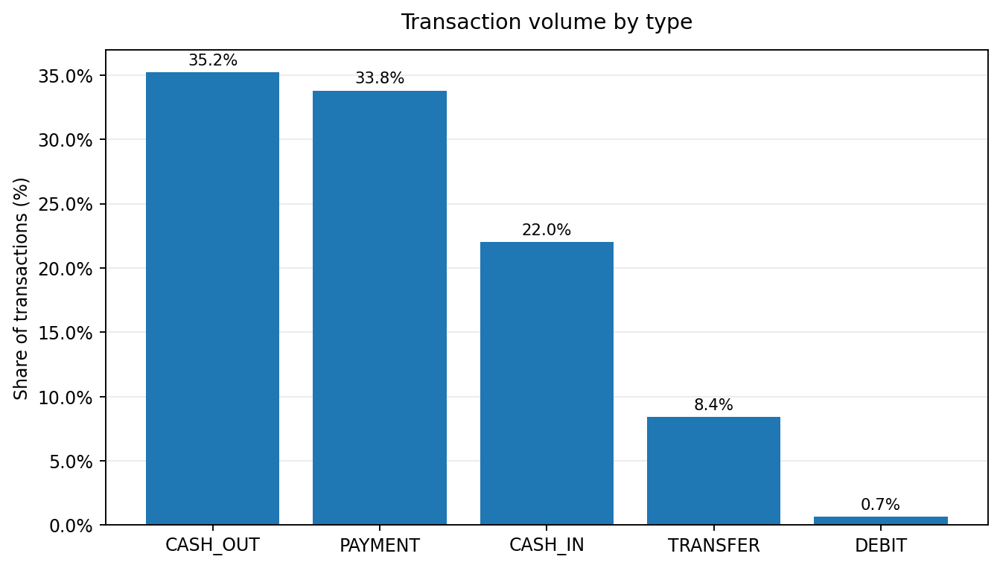
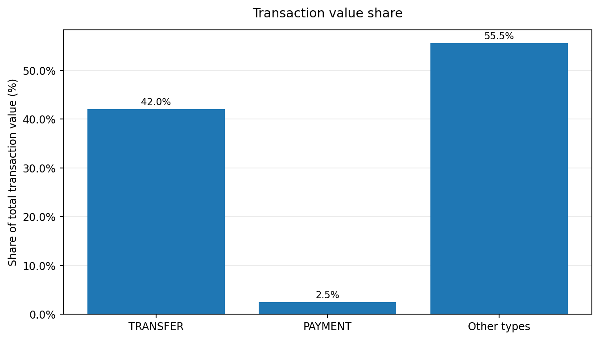
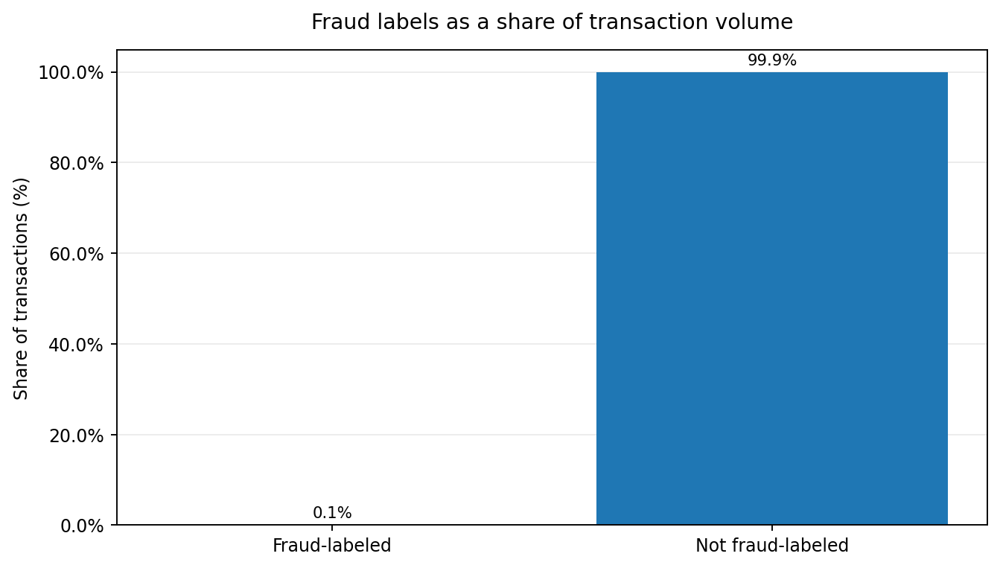
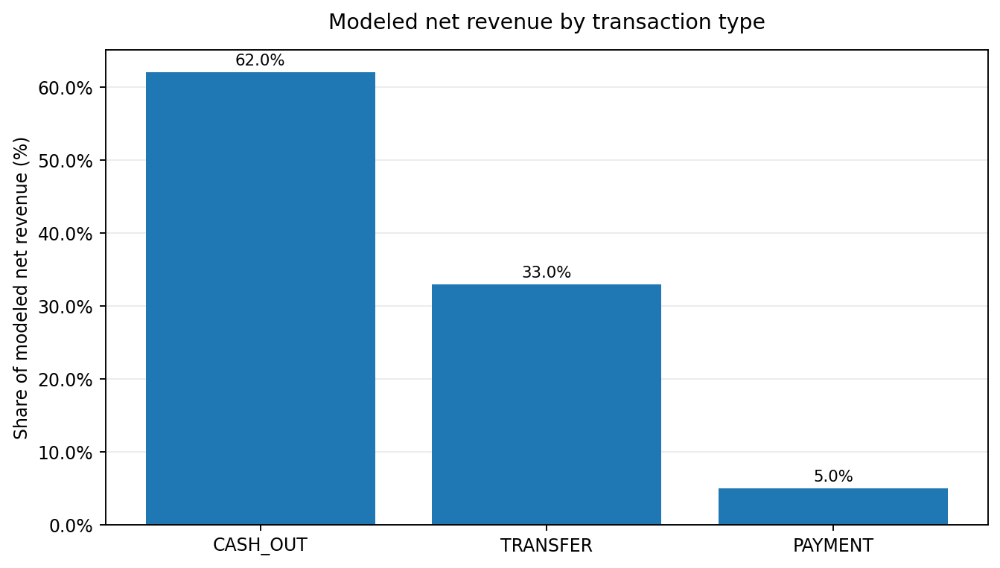

# Digital Wallet Analytics**

Customer Engagement, Transaction Performance, Wallet Balances, and Revenue Analytics

An entry level analytics portfolio project built on 6.36 million simulated mobile-money transactions. Tools: MySQL, Python (pandas), Excel, Power BI.

## 1. Executive summary**

This project analyzes a month of digital wallet activity to answer four questions. Who is active, how do transactions perform, what do balances look like, and where does revenue come from.

The dataset is the public PaySim simulation of a mobile money service. The dataset contains many transactions but lacks several fields needed for operational reporting, including transaction status, fees, registration dates, channels, and balance snapshots. The analysis separates directly observed metrics from proxy measures and scenario-based estimates.

Key findings (reproducible with the project scripts):

1. Volume is 6,362,620 transactions worth 1.14 trillion simulated units. PAYMENT is 34% of volume but 2.5% of value. TRANSFER is 8% of volume but 42% of value.

2. 99.85% of customers transact once in the window. DAU/MAU is 3.2%, which is almost exactly 1/31. The ratio reflects the data structure, not customer loyalty.

3. 93% of volume sits in 14 of 31 days. Volume collapses from day 18. This looks like a simulator artifact, not churn.

4. 8,213 transactions (0.13% of volume, 1.05% of value) are labeled fraud, all in TRANSFER and CASH_OUT. Fraud count stays near 265 a day regardless of volume, so the fraud rate rises from about 0.06% on busy days to 1–3% on quiet days, and to 22% at 03:00–04:00.

5. The built-in system flag caught 16 of the 8,213. A rule for transfers or cash outs that drain the full opening balance captured 8,018 with no false positives. That result is likely helped by how PaySim generates fraud, so treat it as a screening idea to test, not a finished control.

6. Only 43% of transactions have a sender balance change equal to the amount. Balance metrics are therefore indicative only.

7. Under an assumed fee schedule, net revenue is 3.47 billion units. CASH_OUT gives 62%, TRANSFER 33%, PAYMENT 5%. Fraud value is about 3.5 times that net revenue. Both figures depend on the assumed rates.

## Charts

The charts below summarize the transaction mix and the modeled fee scenario. They use rounded aggregate figures reported in this analysis. The revenue figures are estimates based on assumed fee rates, not observed provider revenue.

## 2. Business problem**

A wallet provider needs a consistent view of customer activity, transaction performance, wallet balances, and revenue after partner costs. Without shared definitions, product, risk, and finance teams can end up working from different numbers. This project establishes a consistent set of metrics and uses them to outline a three-page dashboard.

## 3. Business objectives**

1. Define and measure active users with one written definition.

2. Measure transaction volume, value, mix and exception rates.

3. Describe wallet balances using only valid data, and state the limits.

4. Estimate revenue by transaction type and customer segment from an explicit fee scenario.

5. Turn findings into actions for product, risk, finance and data teams.

## 4. Key research questions**

1. How many unique customers transact each day and in the month?

2. How do activity levels change over time and by hour?

3. Who is new, returning or inactive, where the data allows it?

4. How is volume and value split by transaction type and counterparty?

5. What share of transactions show a problem signal (fraud label, balance mismatch)?

6. What do customer balances look like, and how reliable are they?

7. Which transaction types and customer segments drive revenue under a stated fee scenario?

## 5. Intended stakeholders**

Product managers (usage and mix), risk and fraud operations (exception patterns), finance and revenue assurance (fee scenario, concentration), data engineering (data gaps to fix), and hiring managers reviewing the portfolio.

## 6. Analytical scope**

In scope: customer activity, transaction performance, balance integrity, scenario revenue, and a three page dashboard.

Out of scope: predictive modeling, real fee reconciliation, customer lifetime value, and any claim about a real provider.

## 7. Dataset description**

File: PS_20174392719_1491204439457_log.csv (PaySim). One row is one transaction event. Time is measured in hourly steps, 1 to 743.

Fields available: step, type (CASH_IN, CASH_OUT, DEBIT, PAYMENT, TRANSFER), amount, sender account, sender balance before and after, receiver account, receiver balance before and after, isFraud, isFlaggedFraud.

Derived by this project: surrogate transaction_id (row order), day (steps 1 to 24 are day 1; day 31 has 23 hours), hour_of_day, counterparty type (merchant if the receiver starts with M), balance reconciliation flag, billable flag (not fraud labeled), scenario fees.

What the dataset lacks, and what was done instead:

transaction_id: surrogate key. No retries are detectable, so each row is treated as one processed transaction and attempts equal unique transactions.

timestamp: day and hour from step. No weekday can be identified.

transaction status and failure reason: failure rate cannot be measured. Proxies are the fraud label rate and the balance exception rate. Neither is a payment failure.

fee or revenue: none observed. A labeled scenario fee schedule is used.

refunds and chargebacks: not in the data. Net revenue here means gross fee minus partner cost only.

registration date: not available. New means first observed transaction in the window, which makes every day 1 customer look new.

wallet_id: not available. The sender account is treated as one customer with one wallet.

channel: not available. Transaction type and merchant versus customer counterparty are used as the nearest product view.

balance snapshots: not available. Last observed post transaction balance is used and labeled as such.

Recommended fields for a real project: status and failure_reason, fee and partner_fee tables, registration_date, channel, daily balance snapshots, refund and chargeback tables.

## 8. Terminology used**

Transaction volume: count of transactions.

Transaction value: sum of transaction amounts. It is money moved, not money earned.

Revenue: fees earned. Here, a scenario. Gross revenue is fees charged. Net revenue is gross fees less partner costs.

Balance: money held in a wallet at a point in time. It is a stock, not a flow.

Payment failure: a transaction that was attempted but not completed. Not observable here.

Refund: money returned to a customer after a completed payment. Not observable here.

Chargeback: a card network dispute that forces funds back, usually with a fee. Not observable here.

Fraud labeled transaction: a transaction marked as fraud in the data. Its value is exposure, not confirmed loss.

Active user: a sender account with at least one non-fraud transaction in the period.

## 9. Tools and methodology**

1. Load the CSV into MySQL staging (sql/01) and Python.

2. Build a fact table with derived fields (sql/02, python/analysis.py).

3. Run data quality checks before any metric (sql/03, validation_checks.csv).

4. Calculate engagement, performance, balance and revenue metrics (sql/04 to 07).

5. Reconcile SQL against Python. See docs/validation_log.md.

6. Export small summary tables to outputs/ for Excel and Power BI. The full 6.36 million row table is not needed on a laptop.

7. Build the Excel workbook (formula driven fee model) and the Power BI dashboard (docs/powerbi_dashboard_spec.md).

Active user definition: unique sender account with at least one non-fraud transaction in the period. Alternative tested: any customer account that sends or receives. That gives MAU 6.91 million and DAU/MAU 4.3%, still near 1/31.

Balance method: last observed post transaction balance per sender, using all rows and, separately, only rows where the balance change equals the amount. Transaction amounts are never used as balances.

Revenue method: fee = min(amount x gross rate, cap) on non-fraud rows. Partner cost is a fixed share of the fee. Rates are in python/analysis.py and sql/02 and can be changed. Scenarios low, base and high use 0.5×, 1.0×, and 1.5× times the gross rate.

## 10. Deliverables**

README.md, python/analysis.py, python/build_excel.py, sql/01 to 07, outputs/ (19 summary files), excel/wallet_analytics_workbook.xlsx, docs/powerbi_dashboard_spec.md, docs/validation_log.md, docs/business_recommendations.md.

## 11. Key findings**

Engagement. MAU is 6,345,122. Average DAU is 204,962. 6,335,852 customers transact once, 9,270 transact twice or three times. Returning customers per day range from 0 to 1,075. By last active day, 11,019 customers were last seen on day 30 and 54,629 on day 29, so inactivity cannot be separated from the data structure.

Pattern over time. Days 1 and 2 carry 574,255 and 455,238 transactions. Day 3 has 1,070. Days 6 to 17 run 350,000 to 440,000. From day 18, volume falls to between 8,578 and 57,853. Day 31 has 272 rows, all fraud labeled, so its DAU is zero. Hourly, volume peaks at 17:00–19:00 and bottoms at 03:00.

Performance. Average amount is 179,862 and the median is 74,872. CASH_OUT 2.24 million (35.2%), PAYMENT 2.15 million (33.8%), CASH_IN 1.40 million (22.0%), TRANSFER 0.53 million (8.4%), DEBIT 41,432 (0.65%). All PAYMENT transactions go to merchants, all other types go to customer accounts.

Exceptions. Fraud labeled transactions: 8,213 worth 12.06 billion. Balance exceptions: 3,601,595 rows (56.6%), including 2,088,969 debits from a zero opening balance. These make the balance fields unreliable, and any real ledger would not show them.

Balances. Across all senders, the last observed balance is zero for 56.7% of customers and the mean is 856,010. On rows that reconcile, the median is 207,837 and the mean is 1.98 million. The reconciled view is selective and should not be read as the wallet population.

Revenue scenario (assumed rates). Gross 7.12 billion, partner cost 3.65 billion, net 3.47 billion. Average gross fee per billable transaction 1,121. Top 1% of customers by value send 21% of value and earn 7% of net revenue. Top 10% send 52% of value and earn 40% of net revenue. Revenue is less concentrated than value, probably because of the fee cap and the mix of types.

## 12. Recommendations**

See docs/business_recommendations.md. In short: fix data capture first (status, fees, registration, balance snapshots), add a full balance drain rule for transfers and cash outs to fraud screening and test it on real data, review overnight controls, report DAU/MAU only on data with repeat behavior, and treat fee revenue figures as scenarios until fee records exist.

## 13. Assumptions and limitations**

1. The data is simulated. Findings describe the data, not a real provider.

2. Currency is unspecified. All amounts are simulated units.

3. Activity drops sharply after day 17 and looks like a generator artifact.

4. One month only. MAU has a single value and no monthly trend exists.

5. Customers mostly appear once. Engagement ratios, new versus returning and inactive segments are weak.

6. Fee schedule is assumed. Fraud rows are assumed reversed with no fee. No refunds or chargebacks are modelled.

7. Balance fields fail reconciliation on 56.6% of rows. Destination balances reconcile on about 60% of customer receipts and are not used.

8. The fraud rule result is probably optimistic because of how PaySim creates fraud.

9. Fee model in Excel uses band averages and is about 2% above the exact base case.

## 14. How this relates to digital banking and payments operations**

The same questions run every day in a wallet or digital bank. Product teams track active users and transaction mix. Payment operations track failure and decline rates by reason, partner and hour. Risk teams track fraud rates, exposure and the performance of screening rules. Finance tracks fees, partner costs, refunds and chargebacks, and reconciles wallet balances to the ledger. Balance reconciliation errors like the ones found here would trigger an incident in a real organization. This project practices those tasks on a public dataset.

## 15. How to reproduce**

1. Download PaySim and unzip.

2. Run: python python/analysis.py --input PS_20174392719_1491204439457_log.csv --out outputs (about 3 minutes, 2 GB RAM).

3. Run: python python/build_excel.py

4. Optional: edit the path in sql/01 and run sql/01 to 07 in order on MySQL 8. Steps 04 and 06 take several minutes on a laptop.

5. Build the dashboard from outputs/ using docs/powerbi_dashboard_spec.md.
