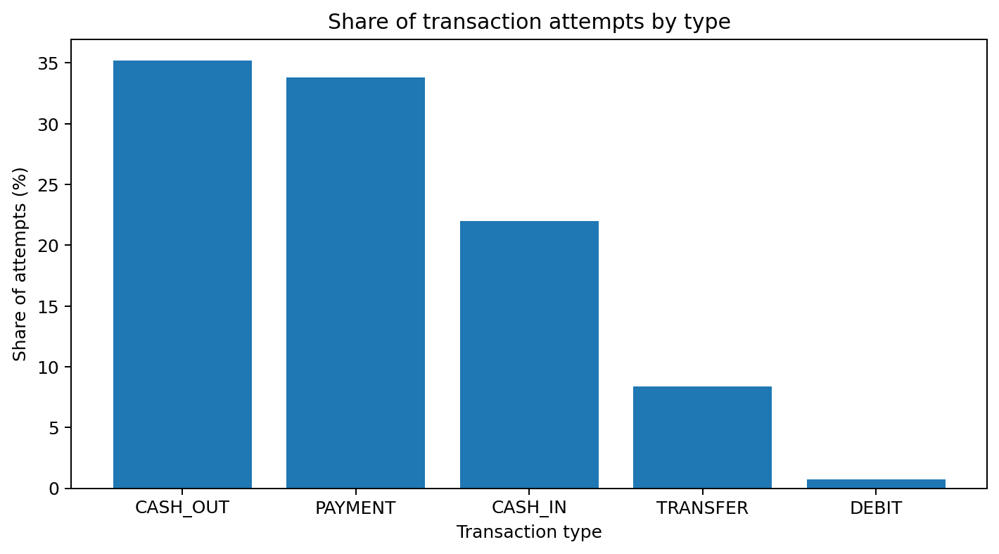
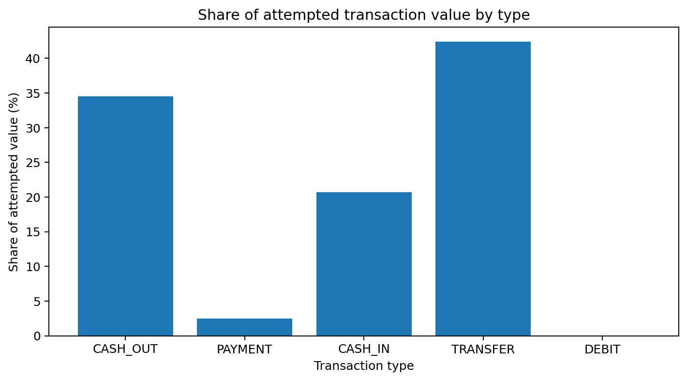
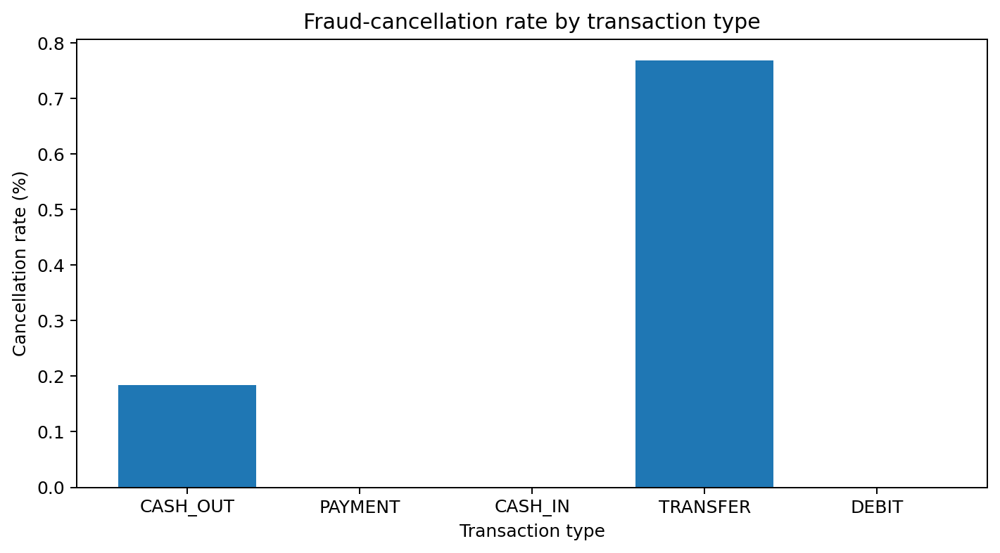
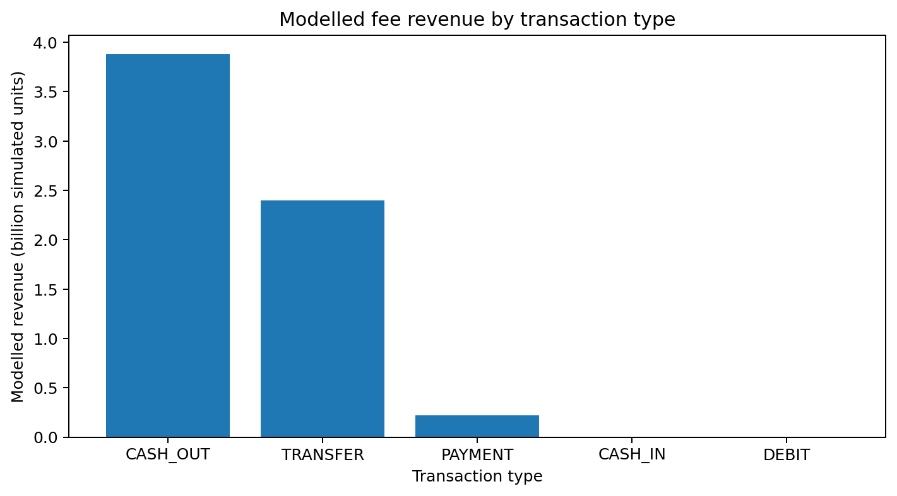

# Digital Wallet Performance & Customer Transaction Analytics

**A entry level portfolio project using the PaySim mobile-money simulation**

This project examines transaction activity, transaction value, cancellation patterns, wallet balances and an illustrative fee model using **6,362,620 simulated transactions across 31 simulated days**. DuckDB is used to query the transaction log, Python to validate the results, and Power BI to present the findings.

> **Data note:** PaySim is synthetic data. The findings describe this simulation, not a real wallet provider. PaySim does not include observed provider fees, customer registration dates, technical failure reasons, refunds or chargebacks. Any fee-revenue figures below are estimates based on stated assumptions.

## Executive summary

The analysis shows why transaction count and transaction value should be monitored together. Transfers account for only **8.4% of transaction attempts but 42.4% of attempted value**, while payments account for **33.8% of attempts but 2.5% of value**. The two measures tell different stories about how the service is used.

The data also has important limitations. Nearly all initiating accounts appear only once, making DAU/MAU unsuitable as a meaningful retention measure in this simulation. The only non-completed state represented is a fraud-related cancellation; the dataset does not identify ordinary payment failures such as declines, timeouts or insufficient funds.

### Key figures

| Metric | Result |
|---|---:|
| Transaction attempts | 6,362,620 |
| Attempted transaction value | 1,144.39 billion simulated currency units |
| Completed transactions | 6,354,407 |
| Completed transaction value | 1,132.34 billion simulated currency units |
| Average amount per attempt | 179,862 |
| Fraud-cancelled transactions | 8,213 (0.129%) |
| Value of fraud-cancelled transactions | 12.06 billion (1.05% of attempted value) |
| Average DAU, initiating accounts | 211,795 |
| MAU, initiating accounts | 6,345,122 |
| DAU/MAU | 3.34% — simulator artefact; see limitations |
| Modelled fee revenue | 6.51 billion, using illustrative rates |
| Median last-observed customer balance | 0 |
| Mean last-observed customer balance | 905,775 |

## Findings at a glance

### 1. Transaction count and value tell different stories





Transfers are a relatively small share of transaction volume but account for the largest share of attempted value. Payments are frequent but comparatively small in value. A useful operational dashboard should therefore include both count and value rather than relying on one alone.

### 2. Fraud-related cancellations



The simulation contains **8,213 fraud-cancelled transactions**, all classified as either `TRANSFER` or `CASH_OUT`. Their median amount is 441,423, compared with 171,034 for completed transfers and cash-outs. About **97.6%** of cancelled transactions exactly empty the sender's opening balance.

This pattern is worth investigating as a potential monitoring rule, not deploying as a standalone decision rule. Legitimate customers can withdraw their full balance, and real-world performance would need to be tested on operational data.

### 3. Wallet balance concentration

The last observed customer balance is not a true end-of-day snapshot. Within that measure, the median balance is zero, and accounts with balances of at least 1 million hold **92.8% of the observed balance**.

| Balance finding | Result |
|---|---:|
| Customer accounts with a last-observed balance | 6,912,642 |
| Median last-observed balance | 0 |
| 75th percentile | 202,865 |
| 90th percentile | 2.28 million |
| 99th percentile | 16.1 million |
| Accounts with a balance of at least 1 million | 915,896 |
| Share of observed balance held by those accounts | 92.8% |

The concentration suggests that balance distribution is important to investigate, but the simulation's balance fields do not behave like a fully reliable accounting ledger.

### 4. Illustrative fee-revenue estimate



PaySim does not contain actual provider fee revenue. For this estimate, the analysis applies the following illustrative rates to completed transaction value:

| Transaction type | Assumed rate |
|---|---:|
| Cash in | 0% |
| Cash out | 1.0% |
| Transfer | 0.5% |
| Merchant payment | 0.8% |
| Debit | 0% |

Under these assumptions, modelled revenue totals **6.51 billion**. Cash out contributes 59.7% and transfers 36.8%. These figures are scenario estimates, not observed earnings; results will change if the assumed tariff changes.

## Business questions

The analysis was designed to answer the following questions:

- How many unique accounts initiate transactions each simulated day and across the full period?
- How do transaction count and value vary by type and simulated day?
- Where do fraud-related cancellations occur, and what patterns distinguish them?
- How are last-observed customer balances distributed?
- Which transaction types and ticket-size bands contribute most to modelled fee revenue under the stated assumptions?

## Dataset selection

PaySim was selected because its transaction-level structure includes transaction type, amount, sender and recipient identifiers, and before/after balance fields. It provides enough rows to examine transaction mix and balance movement at scale.

Other datasets considered in the initial review included the Berka Czech bank dataset, a small digital-wallet transaction dataset, and a synthetic FinTech customer lifetime-value dataset. Their sizes, fields and licensing details were not independently verified for this version of the project, so they were not used in the analysis.

**Primary dataset:** [PaySim mobile money dataset on Kaggle](https://www.kaggle.com/datasets/ealaxi/paysim1)

Check the dataset's current license and terms before redistributing any data.

## What the data can and cannot measure

| Business metric | Coverage in PaySim | Treatment |
|---|---|---|
| Transaction count, value and average amount | Supported | Calculated directly |
| Fraud-related cancellations | Partly supported | `isFraud` is used to identify cancellation; this is not a general payment-failure status |
| Failure reasons | Not available | Not inferred or fabricated |
| Payment channel | Not available | A transaction-type-based proxy is used where needed and labelled as a proxy |
| DAU and MAU | Supported with caveats | Based on initiating account identifiers; not a reliable retention measure in this simulation |
| Registration cohorts and churn | Not available | Registration dates and a pre-existing customer base are absent |
| Wallet balances | Partly supported | Last-observed post-transaction balance, not a daily snapshot |
| Fee revenue | Not available directly | Estimated from a separate, editable set of assumed rates |
| Refunds, chargebacks, partner costs and net revenue | Not available | Not calculated |
| Retries | Not available | There is no retry identifier |

## Method

1. Load the PaySim CSV into DuckDB and create analysis fields such as transaction ID, simulated day, hour, and clearly labelled status/channel proxies.
2. Run SQL queries to calculate the project KPIs.
3. Export analysis tables to `outputs/` for review and dashboard use.
4. Recalculate key measures in pandas and run data-quality checks in `validate.py`.
5. Compare the SQL and Python results; document any differences.
6. Use the exported tables with the Power BI specification in `docs/powerbi_spec.md`.

### Definitions

- **Transaction volume:** number of transaction attempts.
- **Transaction value:** sum of transaction amounts; it is not provider revenue.
- **Modelled revenue:** completed transaction value multiplied by an assumed fee rate.
- **Fraud-cancelled transaction:** a transaction identified as fraud in the simulation; not equivalent to a technical payment failure.
- **Last-observed balance:** the account balance after its last observed completed event in the simulated period, not an end-of-day balance snapshot.

## Validation and data quality

The project compares key outputs from SQL and pandas. The reported totals for completed transaction count and value, cancelled value, MAU, average DAU, modelled revenue, account count, median balance and zero-balance share match across the two approaches. Mean closing balance differs by four units (0.0004%) because of a different tie-break rule for events in the same hour.

Other checks found:

- No duplicate rows and no negative transaction amounts; 16 transactions have zero amount.
- Sender-balance arithmetic is inconsistent for a substantial share of transactions, so the balance columns should not be treated as a complete accounting ledger.
- 56.6% of transactions have an amount greater than the sender's opening balance, even though they are marked completed.
- Merchant accounts show zero balances and are not tracked in the same way as customer accounts.
- Fraud-cancelled rows are excluded from balance analysis.

### Why DAU/MAU needs a caveat

Almost every initiating account appears to make one transaction in the simulated month. As a result, MAU approaches the number of initiating accounts and DAU/MAU is 3.34%. That ratio would usually raise a retention question in a real wallet, but here it primarily reflects how the simulator assigns account identifiers. It should not be interpreted as a real product-retention result.

## Recommendations

1. **Monitor cancellation rate alongside count.** The absolute number of cancellations is relatively stable while transaction volume varies sharply, so rates can spike on low-volume days.
2. **Review full-balance cash-outs and transfers.** The pattern is strong in this dataset, but any rule should be tested in monitoring mode and combined with other signals before operational use.
3. **Retune simple amount-only rules.** The legacy flag identifies very few of the simulated fraud cases, while a broad high-amount threshold would generate a large number of alerts.
4. **Investigate balance concentration.** Accounts with observed balances of at least 1 million hold most of the observed balance, although the balance fields have known quality limitations.
5. **Treat fee results as scenarios.** Validate the assumed tariff with real fee schedules before using revenue estimates for planning.
6. **Collect missing operational data.** Registration dates, payment statuses and reason codes, retry IDs, channels, actual fees and partner costs, refunds and chargebacks would support more reliable engagement and net-revenue measures.

## Limitations

- PaySim is synthetic; findings do not represent a specific real-world provider.
- The data contains simulated day numbers, not calendar dates, so weekday effects cannot be tested.
- Registration dates are absent, preventing registration-cohort and churn analysis.
- Revenue is estimated using assumed fee rates, not observed.
- The only non-completed state used here is fraud-related cancellation, not technical failure.
- The currency is not specified in the dataset; amounts are reported in simulated currency units.
- The balance fields do not consistently reconcile as a full accounting ledger.

## Reproduce the analysis

Install the required packages:

```bash
pip install duckdb pandas matplotlib
```

Download PaySim from Kaggle, unzip the CSV, and place it at:

```text
data/raw/paysim.csv
```

Then run:

```bash
python run_analysis.py
python validate.py
```

The SQL analysis is designed to run on a single-core laptop in under a minute, based on the project author's recorded run.

## Repository structure

```text
sql/                  SQL loading script and KPI queries
outputs/              Exported CSVs, charts and fee assumptions
run_analysis.py       Runs the SQL analysis
validate.py           Independent pandas checks and data-quality tests
docs/powerbi_spec.md  Power BI dashboard specification
charts/               Images used in this README
```

## Tools

- **SQL:** MySQL
- **Analysis and validation:** Python, pandas
- **Charts:** Matplotlib

